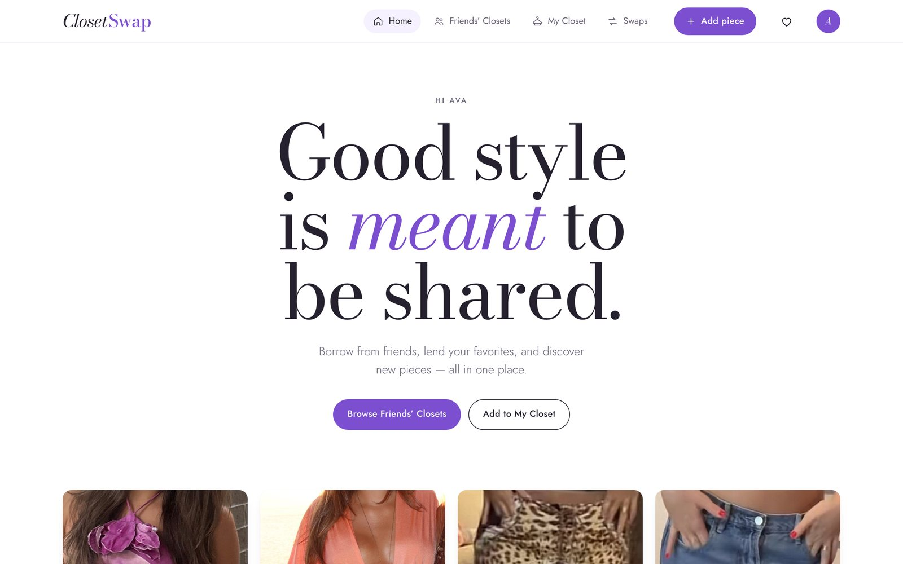
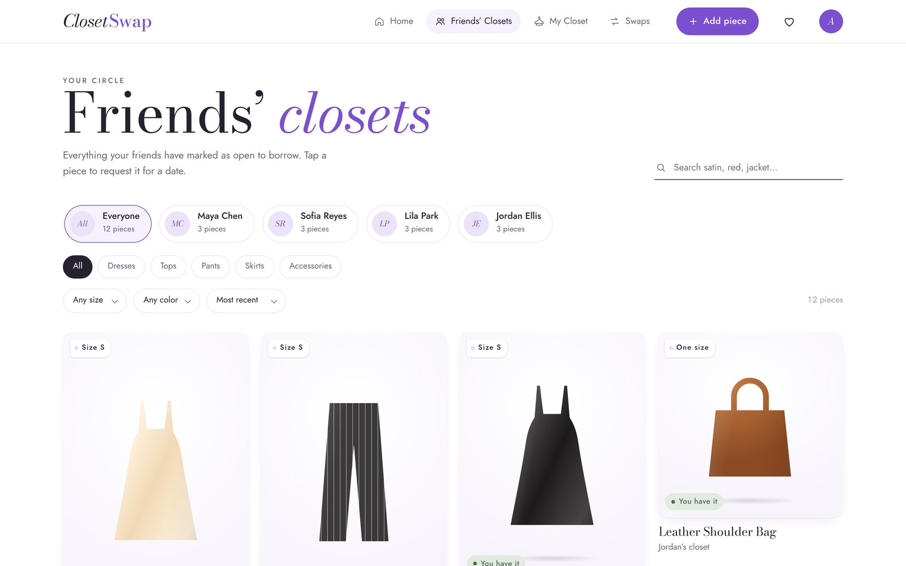
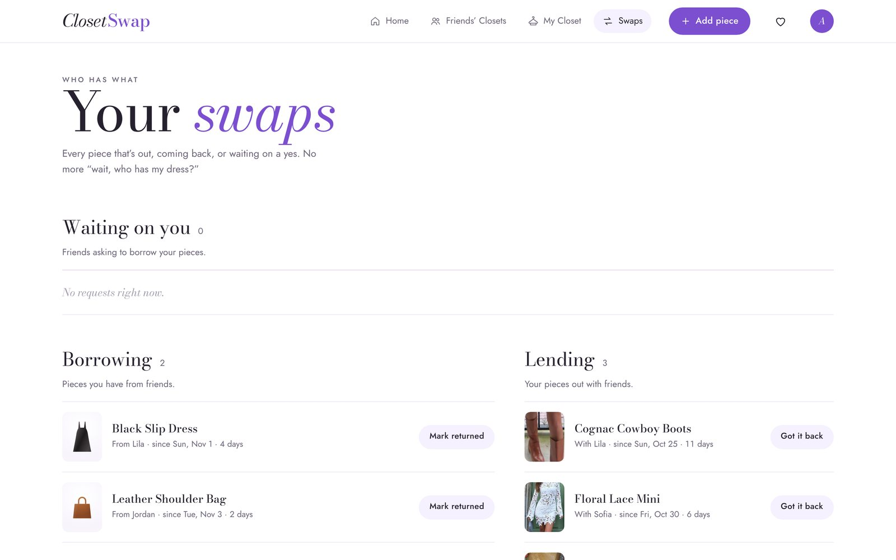
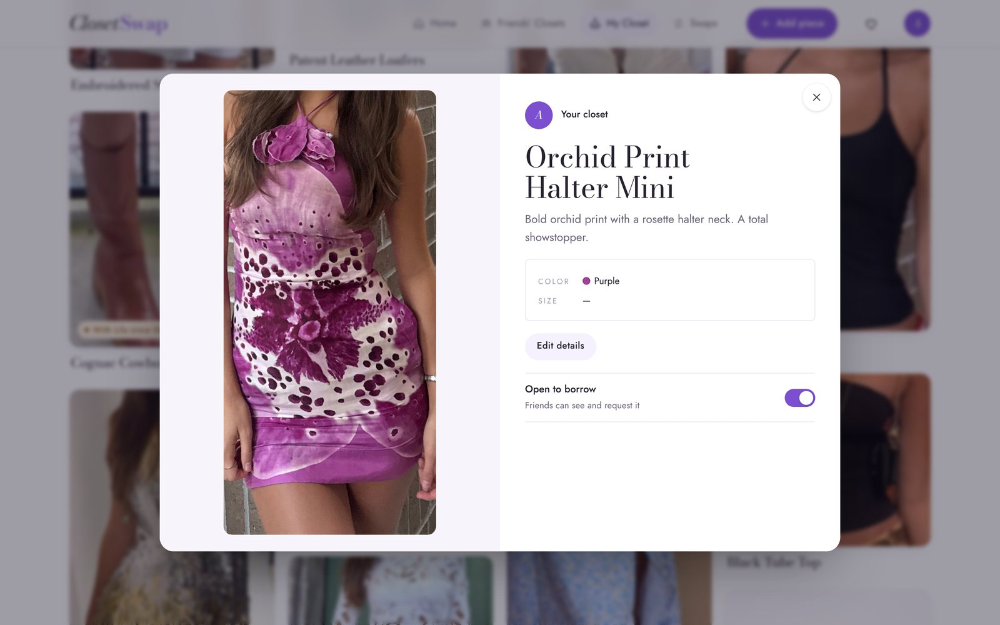
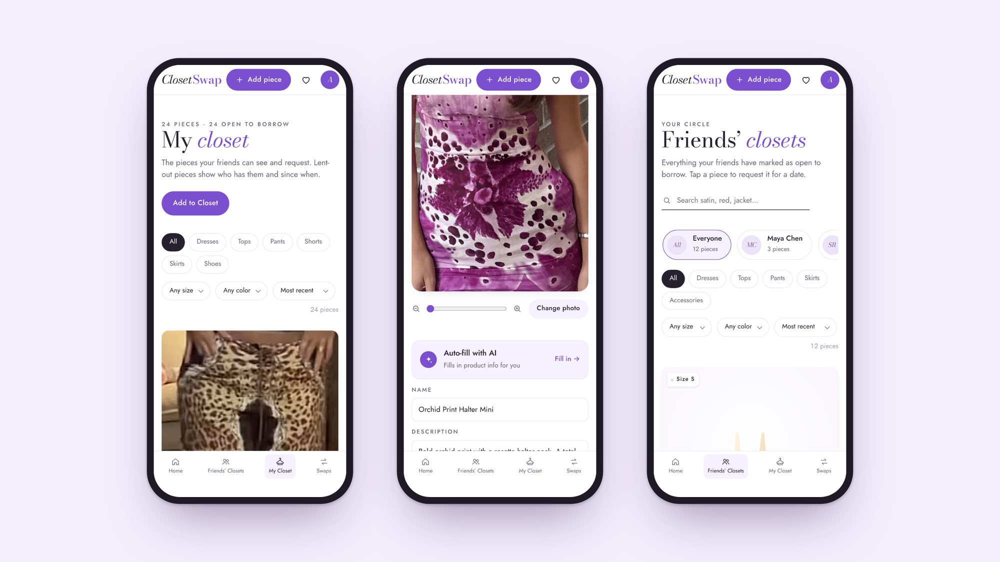

# Closet Swap

**Good style is meant to be shared.** Borrow more. Buy less. Share your style.

Closet Swap is a wardrobe-sharing app for friends. Browse each other's closets, request pieces for a date, lend your favorites, and always know who has what.

**[Open the live app →](https://avasimoneaa.github.io/closet-swap/)** · **[See the landing page →](https://shiny-behaviors-053847.framer.app)**


## Why I built it

I'm the friend everyone borrows clothes from. That meant a lot of "do you still have that dress?" texts, photos sent back and forth to show what I own, and pieces I'd forget I'd lent out. Closet Swap puts every closet in one place: you can see what your friends own, ask to borrow something for a specific night, and track who has what and for how long.

## How I built it

I came up with the concept, directed the design and product decisions, and built it with Claude as my AI coding partner, going from the first idea to a working app with a backend.

- **Design.** I wanted it to feel like a fashion brand, not a spreadsheet. It mixes Pinterest-style browsing, Depop's community feel and Vogue's editorial type: Bodoni Moda headlines over Jost body text, white and violet, with lots of whitespace. I reviewed it on desktop and phone and kept cutting labels until each piece shows only what matters: a name, a description, a color and a size.
- **Real content.** The closet uses my own wardrobe. Each photo is cropped to the garment so the focus stays on the clothes.
- **AI auto-fill.** Adding a piece should take seconds. You upload a photo, drag and zoom to frame it, and tap Auto-fill. Claude looks at the photo and writes the name, category, color and a one-line description, and you can edit anything before saving. It only runs when you ask, so the form never fills itself in unexpectedly.
- **Frontend.** One HTML file with plain JavaScript and CSS and no framework. It has a masonry grid, filters for size, color, print and metallic, a wishlist, a drag-to-crop photo tool and a profile that remembers your sizes.
- **Backend.** A small Node.js server with a built-in SQLite database, photo uploads and an API that calls Claude for labeling. It needs no npm packages, so it runs anywhere Node 22 does.
- **Database and accounts.** On the live site, Supabase handles sign-in, a Postgres database with row-level security, and photo storage. Run locally, a Node server saves to SQLite instead, and without either the app falls back to a demo that saves in your browser.

### What I'd build next

- Notifications when a friend asks to borrow something or a piece comes home
- Outfit suggestions that mix pieces from your closet and your friends' closets

## Screenshots

| Home | Friends' closets |
| --- | --- |
|  |  |
| **Swaps** | **Piece detail** |
|  |  |



## Features

- **Home** with a pinned welcome, your closet scrolling over it, and a summary of what you're borrowing, lending and being asked for
- **Friends' Closets** in a Pinterest-style grid, filtered by friend, category, size and color (including Print and Metallic), sorted by most recent or most popular
- **My Closet** with who has anything that's lent out and since when, plus editing for name, description, color, size and category
- **Add a piece**: upload a photo, drag and zoom to crop it, and optionally auto-fill the details with AI
- **Swaps** to approve or decline requests and track what's out
- **Wishlist** for pieces you've hearted in friends' closets
- **Profile** with your height and sizes for tops, dresses, bottoms, jeans and shoes

## How it's built

```
closet-swap/
├── public/            Frontend (one HTML file: markup, styles and JavaScript)
│   ├── index.html
│   ├── config.js      Supabase URL and anon key (empty = demo mode)
│   └── img/           Closet photos
├── server/            Backend (Node.js, no npm packages)
│   ├── server.js      Web server and JSON API
│   ├── db.js          SQLite database
│   ├── ai.js          AI auto-fill using the Claude API
│   └── env.js         Reads settings from .env
├── supabase/
│   └── schema.sql     Tables, security rules and photo storage for Supabase
├── uploads/           Photos you add (created automatically, not committed)
├── data/              The database file (created automatically, not committed)
├── .env.example       Settings template
└── package.json
```

The backend uses only what comes with Node.js 22.5 or newer, including its built-in SQLite database, so there is nothing to install.

## Run it on your computer

1. Install [Node.js](https://nodejs.org) version 22.5 or newer.
2. In this folder, copy the settings template:
   ```
   cp .env.example .env
   ```
3. To turn on AI auto-fill, open `.env` and paste your key from [console.anthropic.com](https://console.anthropic.com) after `ANTHROPIC_API_KEY=`. You can skip this; everything else works without it.
4. Start the app:
   ```
   npm start
   ```
5. Open **http://localhost:3000**.

Pieces you add, swaps, your profile and your wishlist are saved in `data/closet.db`, and new photos go in `uploads/`. Use `npm run dev` to restart the server automatically when you edit a file.

## API

| Method | Route | What it does |
| --- | --- | --- |
| GET | `/api/health` | Checks the server is up and whether AI auto-fill is on |
| GET | `/api/state` | Everything saved, grouped by collection |
| PUT | `/api/:collection/:id` | Saves a record (`items`, `requests`, `exState`, `prefs`, `profile`, `wishlist`) |
| DELETE | `/api/:collection/:id` | Deletes a record |
| POST | `/api/upload` | Saves a photo (`{ "dataUrl": "data:image/jpeg;base64,…" }`) and returns its URL |
| POST | `/api/label` | Sends a photo to Claude and returns name, category, color and description |

## Online database and sign-in (Supabase)

The live site uses [Supabase](https://supabase.com) for accounts, the database and photo storage, with no server needed. Signed in, your pieces, swaps, profile and wishlist save online, and anyone else who signs up shows up in your Friends' Closets. Signed out, visitors see the demo closet.

1. Create a free Supabase project.
2. Open **SQL Editor → New query**, paste in [`supabase/schema.sql`](supabase/schema.sql), and click **Run**. This creates the tables, the security rules and the `closet-photos` storage bucket.
3. Go to **Authentication → URL Configuration** and set **Site URL** to your live site, for example `https://avasimoneaa.github.io/closet-swap/public/`.
4. Copy the **Project URL** and **anon public** key from **Project Settings → API** into [`public/config.js`](public/config.js).
5. Sign up on the live site. To load the starter closet into your account, visit `#import-starter` once (for example `…/closet-swap/public/#import-starter`).

The anon key is meant to be public. The security rules keep closets visible only to signed-in people and let each person change only their own pieces, profile and wishlist. Never put the `service_role` key in this repo.

## Deploy on Cloudflare Workers

`wrangler.jsonc` serves the `public` folder and runs `worker/index.js` for AI auto-fill. Connect the repo in **Workers & Pages**, then add `ANTHROPIC_API_KEY` under **Settings → Variables and Secrets** as a secret, and add the `workers.dev` URL to Supabase's **Redirect URLs**.

## Demo mode

If you open the frontend with no Supabase settings in `config.js` and no server running, it runs in demo mode. Everything works except AI auto-fill, and changes are saved in that browser only. To publish the demo, go to **Settings → Pages**, choose **Deploy from a branch**, pick **main**, and save.

## Putting it online for real

GitHub Pages can't run the server. To share the full app, deploy this folder to a host that runs Node.js, such as [Render](https://render.com) or [Railway](https://railway.app):

- Start command: `npm start`
- Environment variable: `ANTHROPIC_API_KEY`
- Add a persistent disk mounted at the project folder (or set `DB_FILE`) so the database and `uploads/` survive restarts.

## Good to know

- **Accounts are live.** Anyone can sign up on the live site. Signed in, Friends' Closets shows everyone else who has an account; signed out, you see the demo closet with illustrated sample friends.
- **The local server has no sign-in.** Run that way, it's one shared closet, so only use it for yourself or people you trust.
- **AI auto-fill runs on the Cloudflare version and the local server.** On Cloudflare, a Worker (`worker/index.js`) handles `/api/label` for signed-in users only, using an `ANTHROPIC_API_KEY` secret set in the Cloudflare dashboard. The GitHub Pages copy has no backend, so there you fill in the details yourself.

## License

The code is released under the [MIT License](LICENSE). The photos in `public/img/` are personal and not included in that license; all rights reserved.
